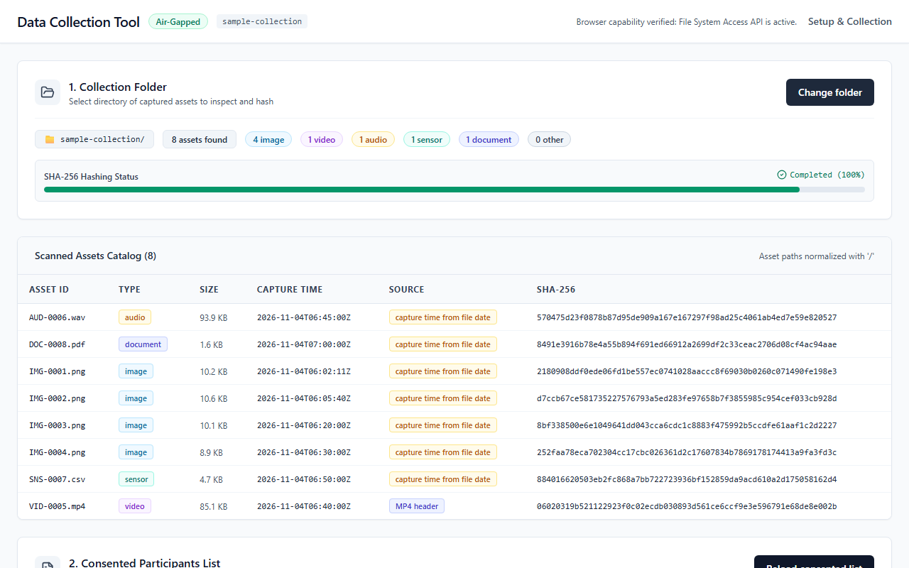
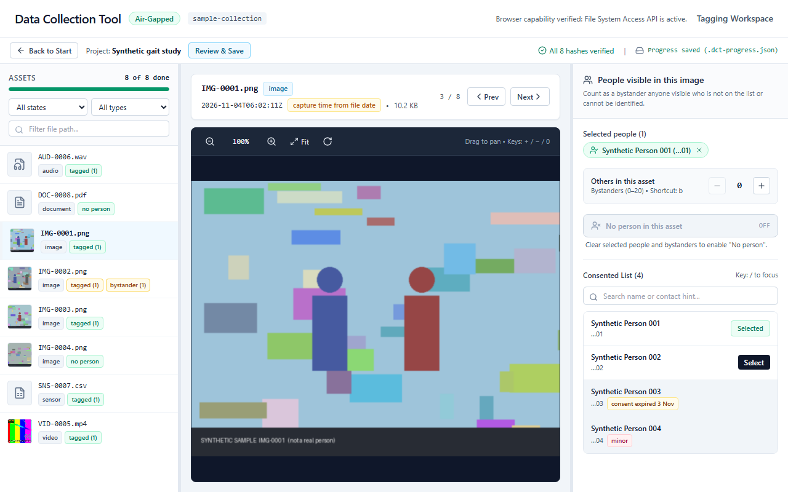
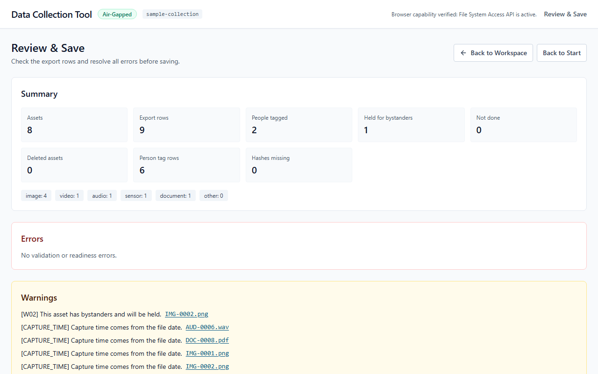
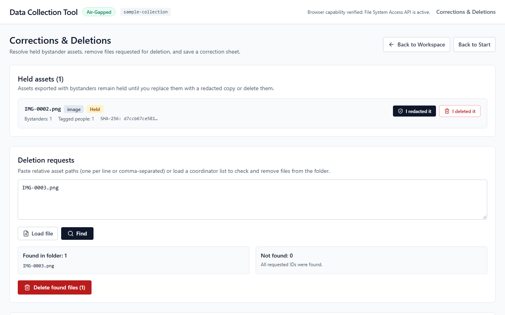

# Data Collection Tool (DCT)

A **100% client-side, air-gapped browser application** for lab data collection machines. Collection agents open a local folder of captured multi-modal files (images, video, audio, sensor recordings, documents) alongside the project's consented participants list, inspect and tag who appears in each file, and save a validated CSV **metadata sheet** directly into the collection folder.

- **No backend, no uploads, no telemetry** — after initial page load, Content Security Policy enforces `connect-src 'none'`.
- **Non-destructive by design** — original captured files are never converted, renamed, re-encoded, or overwritten during tagging or export; the metadata sheet binds each record to its file by relative path (`asset_id`) and streaming **SHA-256** checksum.
- **Privacy boundary** — participant names (`display_name`) and contact hints stay strictly in volatile RAM and are never written to browser storage, `.dct-progress.json`, URLs, logs, or error messages.
- **All 5 implementation increments delivered** — browser gate, folder & list ingestion, tri-pane tagging workspace with multi-modal viewers, deterministic review & CSV export with Python validator parity, crash-safe resume & held-asset corrections/deletions, WCAG 2.1 AA keyboard accessibility, and 1,000-asset / 4 GB video scale hardening.

---

## Core Compliance & Data-Integrity Rules

| Invariant | Behavior Enforced by DCT |
|---|---|
| **Air-gapped execution** | Strict CSP (`default-src 'self'; img-src 'self' blob:; media-src blob:; frame-src blob:; object-src 'none'; connect-src 'none'; script-src 'self'; style-src 'self' 'unsafe-inline'`). Zero network requests after load. |
| **Identifiers copied, never typed** | `project_id`, `person_id`, and `consent_id` have zero free-text inputs anywhere in the UI. `consent_id` is resolved from the in-memory consented list row when exporting. |
| **Selectability lockouts** | Minors (`is_minor = true`), expired consents (relative to asset capture time), and expired consented lists (`list_valid_until`) cannot be selected. |
| **One row per person per asset** | Export sheets emit one `person` row per consented participant, optional `bystander` row (1–20), or mutually exclusive `no_person` / `deleted` row. |
| **Bystander hold discipline** | Bystanders are always recorded and cannot be dropped to pass validation. Assets exported with bystanders stay **held** until externally redacted (verified by a changed SHA-256 on disk) or deleted. |
| **Pre-save golden validation** | `src/validation/validateExport.ts` is a full TypeScript port of `tools/validate_export.py` (`L01–L04`, `E01–E16`, `W01–W02`). **Save sheet** is disabled while any error exists. |
| **Identifiers-only resume** | `.dct-progress.json` auto-saves atomically within 1 second of edits and stores identifiers/flags only—zero participant names or contact hints. |

---

## Application Screens

| Start & Resume Screen | Tagging Workspace |
|---|---|
|  |  |

| Review & Save Screen | Corrections & Deletions Screen |
|---|---|
|  |  |

*(All screenshots use 100% synthetic data from `docs/consent-tagging/examples/`.)*

1. **Browser Gate**: Verifies File System Access API (`showDirectoryPicker`) on desktop **Google Chrome** or **Microsoft Edge**; displays a clear notice on unsupported browsers (e.g. Firefox).
2. **Start Screen**: Opens a collection folder (recursive discovery, optional `dct-types.json` extension overrides, EXIF / O(1) ISOBMFF MP4/MOV header capture-time extraction, 2-worker 8 MB streaming SHA-256 hashing), loads and validates the consented list CSV in RAM, reconciles existing `.dct-progress.json` (`restored`, `untagged`, `missing`, `changed`), enforces project ID match (`RESUME_MISMATCH`), and displays the 7-day consented-list deletion reminder (`R-37`).
3. **Tagging Workspace**: Keyboard-operable resizable tri-pane layout with a virtualized asset list (handles 1,000+ assets smoothly with `< 100` active DOM rows), native multi-modal viewers (image pan/zoom, video speed & `±1f` frame step, audio waveform/scrub, 200-line sensor text preview, PDF frame, fallback guidance for `.heic`/`.mkv`/other), and the People Panel (display name / contact hint search, bystander stepper `0–20`, `no_person` mutual exclusivity, held-bystander floor).
4. **Review & Save**: Audits all assets against `validateExport`, warns on filenames containing participant names (`R-30`), blocks save on any error, writes collision-safe `asset_export_<collection_ref>_<YYYYMMDDTHHMMSSZ>.csv` directly into the folder (plus download copy), and updates `.dct-progress.json` `saves[]`.
5. **Corrections & Deletions**: Resolves held bystander assets (**I redacted it** re-hashes from disk and refuses unchanged SHA-256; **I deleted it** removes/confirms deletion), processes consent-withdrawal deletion lists (Found vs. Not Found partition with single batch confirmation), and exports validated correction-only CSVs (`asset_export_<collection_ref>_correction_<YYYYMMDDTHHMMSSZ>.csv`).

---

## Tech Stack & Prerequisites

- **Supported Runtime Browsers**: Desktop **Google Chrome** or **Microsoft Edge** (served over `http://127.0.0.1`, `http://localhost`, or HTTPS for File System Access API).
- **Frontend Stack**: React 18, TypeScript (strict mode), Vite 5 static build, Tailwind CSS 3, Lucide icons.
- **Core Libraries**: `papaparse` (RFC 4180 CSV), `zod` (progress schema validation), `exifr` (EXIF capture time), `mp4box` (MP4/MOV metadata + custom O(1) ISOBMFF box walker for >4 GB video), `hash-wasm` + Web Worker FIPS 180-4 streaming SHA-256.
- **Testing & Tooling**: Node.js 20+, npm, Vitest + React Testing Library + jsdom, Playwright (Chromium & Firefox) + `@axe-core/playwright` (WCAG 2.1 AA), ESLint 9 flat config (`--max-warnings 0`), Python 3.9+ (stdlib only for `tools/validate_export.py`).

---

## Quick Start

### 1. Install Dependencies

```bash
npm ci
```

### 2. Run Locally

**Development server** (`http://127.0.0.1:5173`):

```bash
npm run dev
```

**Production static build & preview** (`http://127.0.0.1:4173` — recommended for lab deployment and full CSP parity):

```bash
npm run build
npm run preview
```

Open Chrome or Edge to `http://127.0.0.1:4173` (or `http://127.0.0.1:5173` in dev mode).

> **Tip when trying the synthetic sample collection**: Copy `docs/consent-tagging/examples/sample-collection/` to a temporary directory before opening it in DCT so your test exports, `.dct-progress.json`, redactions, or deletions do not modify the tracked fixture folder in Git.

### 3. Run the Python Reference Validator

No `pip` installs are required (Python 3.9+ standard library only):

```bash
python tools/validate_export.py \
  --list   docs/consent-tagging/examples/consented_list.sample.csv \
  --export docs/consent-tagging/examples/asset_export.sample.csv \
  --now    2026-11-05T12:00:00Z
# WARNING W02 ... IMG-0002.png    VALID: 11 rows, 8 assets, 0 errors, 1 warnings

python -m unittest tools/test_validate_export.py
```

---

## Available Scripts

| Command | Description |
|---|---|
| `npm run dev` | Start Vite dev server at `http://127.0.0.1:5173` (`hmr: false`, CSP headers enabled). |
| `npm run build` | Run `tsc --noEmit` followed by production Vite static bundle into `dist/`. |
| `npm run preview` | Serve production `dist/` bundle at `http://127.0.0.1:4173` with strict CSP headers. |
| `npm run typecheck` | Run TypeScript strict type-checking (`tsc --noEmit`). |
| `npm run lint` | Run ESLint across the repository (`eslint . --max-warnings 0`). |
| `npm test` | Execute all Vitest unit, adversarial, and golden-parity suites once (`vitest run`). |
| `npm run test:watch` | Run Vitest in interactive watch mode. |
| `npm run e2e` | Build, serve `dist/` on `127.0.0.1:4173`, and run Playwright E2E + axe suites across Chromium & Firefox. |
| `python -m unittest tools/test_validate_export.py` | Run the 20 reference validator tests (including all 18 golden CSV cases). |

---

## Repository & Project Structure

```text
dct-app/
├── .gitattributes                         # Preserves canonical LF bytes for sample & golden fixtures on Windows
├── .gitignore                             # Ignores node_modules, dist, reports, caches, local drafts
├── AGENTS.md                              # Non-negotiable architectural & governance rules for coding agents
├── CLAUDE.md                              # Coding-agent pointer to AGENTS.md
├── README.md                              # Project overview, setup, structure, and verification guide
├── index.html                             # SPA entry document with air-gapped CSP <meta> policy
├── package.json                           # Scripts and locked dependencies
├── package-lock.json                      # Deterministic npm dependency lockfile
├── tsconfig.json                          # Strict TypeScript configuration (@/* path alias)
├── tsconfig.node.json                     # Node/tooling TypeScript configuration
├── vite.config.ts                         # Vite build/dev/preview config, CSP headers, Windows junction cwd alignment
├── vitest.config.ts                       # Vitest jsdom test config & canonical root resolution
├── playwright.config.ts                   # Playwright E2E runner (Chromium + Firefox against preview server)
├── eslint.config.js                       # ESLint 9 flat config (TypeScript + React Hooks + Refresh)
├── tailwind.config.js                     # Tailwind CSS config (system font stack only — no remote fonts)
├── postcss.config.js                      # PostCSS pipeline (Tailwind + Autoprefixer)
│
├── src/                                   # Application source code (React 18 + strict TypeScript)
│   ├── main.tsx                           # React root mount
│   ├── vite-env.d.ts                      # Vite client ambient types
│   ├── styles/
│   │   └── index.css                      # Tailwind directives & base accessible styles
│   ├── types/
│   │   ├── file-system-access.d.ts        # File System Access API supplemental type declarations
│   │   └── mp4box.d.ts                    # mp4box.js TypeScript module declarations
│   ├── app/                               # Application shell, browser gate & top-level pipeline
│   │   ├── App.tsx                        # 4-screen router (Start, Workspace, Review, Corrections) & shell
│   │   ├── BrowserGate.tsx                # Desktop Chrome/Edge File System Access capability gate
│   │   ├── capabilities.ts                # Runtime File System Access feature detection
│   │   └── useAppPipeline.ts              # Central hook: folder scan, hash workers, RAM list store, reconciliation
│   ├── folder/                            # Local filesystem ingestion, hashing & progress persistence
│   │   ├── index.ts                       # Barrel exports
│   │   ├── types.ts                       # FolderAsset, CaptureTimeSource, ProgressDocument & reconciliation types
│   │   ├── scanner.ts                     # Recursive directory discovery (skips dotfiles & asset_export_*.csv)
│   │   ├── classifier.ts                  # Extension-to-asset_type classifier & dct-types.json override loader
│   │   ├── captureTime.ts                 # EXIF, O(1) ISOBMFF MP4/MOV header walker & file-mtime UTC extraction
│   │   ├── sha256.ts                      # Streaming 8 MB FIPS 180-4 SHA-256 & computeFileSha256 helper
│   │   ├── hashWorker.ts                  # Web Worker (64 MB SubtleCrypto fast path + streaming fallback)
│   │   ├── hashManager.ts                 # 2-worker hashing queue with 100 ms throttled progress notifications
│   │   ├── fsHelpers.ts                   # Relative-path handle lookup, existence check & safe file removal
│   │   ├── progressWriter.ts              # Identifiers-only .dct-progress.json atomic writer & 1 s debouncer
│   │   └── progressReader.ts              # Zod validation, disk reconciliation, held tracking & 7-day reminder check
│   ├── list/                              # Consented participants list engine (RAM-only)
│   │   ├── index.ts                       # Barrel exports
│   │   ├── types.ts                       # ConsentedPerson, ConsentedListResult & selectability types
│   │   ├── parser.ts                      # Strict UTF-8 (no BOM) RFC 4180 CSV parser
│   │   ├── validator.ts                   # Rules L01–L04 whole-file validation
│   │   └── selectability.ts               # Minor, consent_expires_at vs captured_at, and list_valid_until rules
│   ├── tagging/                           # Tri-pane tagging workspace & state machine
│   │   ├── index.ts                       # Barrel exports
│   │   ├── types.ts                       # Workspace state, asset tag records & filter types
│   │   ├── reducer.ts                     # Tagging state machine (exclusivity, held lock, redaction/deletion actions)
│   │   ├── selectors.ts                   # Derived completion (isAssetDone), counts & filtered asset lists
│   │   ├── useTaggingWorkspace.ts         # Workspace controller binding reducer + debounced progress auto-save
│   │   ├── TaggingWorkspace.tsx           # Resizable 3-pane layout, keyboard shortcuts & splitter handlers
│   │   ├── AssetListPane.tsx              # Virtualized asset list (<100 DOM nodes), thumbnails, filters & badges
│   │   └── PeoplePanel.tsx                # Participant search, select/remove chips, bystander stepper & no-person toggle
│   ├── viewers/                           # Multi-modal local Blob URL viewers
│   │   ├── index.ts                       # Barrel exports
│   │   ├── mimeTypes.ts                   # MIME resolution & preview-capability classification
│   │   ├── CenterViewerPane.tsx           # Viewer host, metadata bar, Prev/Next, missing/deleted/changed banners
│   │   ├── ImageViewer.tsx                # Pan/zoom image inspection (+/-/0 shortcuts)
│   │   ├── VideoViewer.tsx                # Video player with playback speed (0.5x–2x), ±1f step & ended tracking
│   │   ├── AudioViewer.tsx                # Audio player with waveform/scrub & ended tracking
│   │   ├── SensorViewer.tsx               # Scrollable keyboard-accessible 200-line preview with chunk cancellation
│   │   ├── DocumentViewer.tsx             # Embedded PDF blob viewer frame
│   │   └── FallbackViewer.tsx             # Standardized fallback & external-review toggle for unsupported formats
│   ├── review/                            # Pre-save audit & full export sheet generation
│   │   ├── index.ts                       # Barrel exports
│   │   ├── types.ts                       # Review summary, warning & export result types
│   │   ├── sheetWriter.ts                 # RFC 4180 CSV builder, PII filename check (R-30), collision-safe naming
│   │   ├── useReviewExport.ts             # Validation orchestration, folder write + download copy + recordSave
│   │   └── ReviewScreen.tsx               # Errors/warnings checklist, jump-to-asset links & gated Save button
│   ├── corrections/                       # Post-export held-asset redaction & deletion requests
│   │   ├── index.ts                       # Barrel exports
│   │   ├── types.ts                       # Held item, deletion-request partition & correction preview types
│   │   ├── correctionSheetWriter.ts       # Correction-only CSV builder, validator & Rule 8 finding sanitizer
│   │   ├── useCorrections.ts              # Disk re-hash verification, single/batch delete & correction export
│   │   └── CorrectionsScreen.tsx          # Held assets panel, deletion-request paste/upload & correction save UI
│   ├── validation/                        # Canonical export validator (TypeScript port of Python reference)
│   │   ├── index.ts                       # Barrel exports
│   │   ├── types.ts                       # ValidationFinding, error/warning codes (L01–L04, E01–E16, W01–W02)
│   │   └── validateExport.ts              # Faithful rule-for-rule port matching golden expected.json
│   └── ui/                                # Start screen & shared presentation components
│       ├── index.ts                       # Barrel exports
│       ├── types.ts                       # Start screen prop contracts
│       ├── StartScreen.tsx                # Folder + list setup, collection_ref input & Start/Resume CTA
│       ├── FolderSection.tsx              # Folder picker trigger, scan summary & hash progress bar
│       ├── AssetTable.tsx                 # Scanned asset preview table (capped at 100 initial rows for scale)
│       ├── ListSection.tsx                # Single-tab-stop keyboard-accessible consented list file input
│       ├── ListSummary.tsx                # Project metadata & valid/ineligible participant counts
│       ├── ParticipantTable.tsx           # Read-only participant status table (selectable / minor / expired)
│       ├── ListErrorBanner.tsx            # L01–L04 & RESUME_MISMATCH refusal feedback
│       └── ResumeBanner.tsx               # Reconciled resume counts, last save details & 7-day reminder (R-37)
│
├── tests/                                 # Vitest automated unit, integration & adversarial suites (28 test files)
│   ├── setup.ts                           # Testing Library & DOM environment bootstrap
│   └── unit/
│       ├── browserGate.test.tsx           # Browser File System Access gate tests
│       ├── security/
│       │   └── csp.test.ts                # CSP meta policy & connect-src 'none' verification
│       ├── folder/
│       │   ├── mockFileSystem.ts          # In-memory FileSystemDirectoryHandle / FileSystemFileHandle test double
│       │   ├── scanner.test.ts            # Recursive discovery & exclusion rules
│       │   ├── classifier.test.ts         # Default types & dct-types.json overrides
│       │   ├── captureTime.test.ts        # EXIF, ISOBMFF MP4/MOV (including >4 GB moov offset) & mtime fallback
│       │   ├── hashing.test.ts            # Streaming SHA-256 vectors & worker manager
│       │   ├── progressWriter.test.ts     # Identifiers-only .dct-progress.json serialization & atomic write
│       │   ├── progressReader.test.ts     # Reconciliation (missing/untagged/changed/deleted) & 7-day reminder
│       │   ├── adversarial.test.ts        # Malformed paths, edge filenames & ingestion hardening
│       │   └── adversarial_m2.test.ts     # Progress persistence & multi-modal edge hardening
│       ├── list/
│       │   ├── parser.test.ts             # UTF-8 BOM rejection & RFC 4180 parsing
│       │   ├── validator.test.ts          # Rules L01–L04 validation cases
│       │   ├── selectability.test.ts      # Minor, consent expiry & list_valid_until boundary cases
│       │   ├── privacy.test.ts            # Zero PII leakage into storage/URL/progress checks
│       │   └── adversarial_m3.test.ts     # Adversarial list & consent tampering checks
│       ├── tagging/
│       │   ├── reducer.test.ts            # Exclusivity, bystander bounds & missing-asset guards
│       │   ├── resumeReducer.test.ts      # Resume hydration & R-34 held bystander floor enforcement
│       │   └── TaggingWorkspace.test.tsx  # Tri-pane workspace interaction & keyboard tests
│       ├── viewers/
│       │   └── viewers.test.tsx           # Image, video, audio, sensor, document & fallback viewer tests
│       ├── review/
│       │   ├── sheetWriter.test.ts        # Export CSV generation, R-30 PII filename warning & collision suffixing
│       │   └── ReviewScreen.test.tsx      # Pre-save audit, error blocking & export workflow
│       ├── corrections/
│       │   ├── correctionSheetWriter.test.ts # Correction-only CSV generation & Rule 8 finding sanitization
│       │   └── useCorrections.test.tsx    # Hash-verified redaction & batch deletion request logic
│       ├── validation/
│       │   ├── goldenCases.test.ts        # Executes all 18 golden CSV cases against expected.json
│       │   └── validateExport.test.ts     # Rule-by-rule validator unit coverage
│       └── ui/
│           ├── StartScreen.test.tsx       # Start screen setup, validation & ResumeBanner tests
│           ├── adversarial_m4.test.tsx    # RESUME_MISMATCH & R-34 UI bypass protection
│           └── adversarial_data_privacy_m4.test.tsx # Cross-screen name-isolation privacy tests
│
├── e2e/                                   # Playwright end-to-end & accessibility specs (8 spec files)
│   ├── t02-browser-network.spec.ts        # T-02.5 Firefox gate + zero post-load network verification
│   ├── t02-adversarial-csp.spec.ts        # Runtime CSP enforcement (connect-src 'none')
│   ├── start-screen.spec.ts               # T-01, T-02, T-03 Start screen, folder scan & list validation
│   ├── tagging-workspace.spec.ts          # T-04, T-05, T-06 Tagging, selectability & multi-modal viewers
│   ├── review-export.spec.ts              # T-07, T-08 Review audit, save & Python CLI export validation
│   ├── corrections-resume.spec.ts         # T-10, T-11, T-12, R-37 Resume, redaction & batch deletions
│   ├── adversarial-data-privacy.spec.ts   # End-to-end zero-PII storage/progress/DOM checks
│   └── finish-scale-a11y.spec.ts          # T-13a/b (axe WCAG 2.1 AA + keyboard-only), T-14 (1,000 files), T-16a/b (immutability + 4 GiB MP4)
│
├── tools/                                 # Canonical Python reference validator (zero external packages)
│   ├── validate_export.py                 # Standalone CLI & JSON validator for consented lists and export CSVs
│   └── test_validate_export.py            # 20 unit tests verifying all 18 golden CSV cases
│
└── docs/consent-tagging/                  # Specifications, operator guide, synthetic fixtures & history
    ├── overview.md                        # Problem statement, roles & lifecycle overview
    ├── app-design.md                      # Screen specs, state model, stack & security architecture
    ├── data-contract.md                   # Formal CSV schemas, UUID/UTC rules & validation codes
    ├── use-cases.md                       # Formal use cases UC-01 through UC-08 & requirements R-01–R-41
    ├── acceptance-tests.md                # End-to-end acceptance criteria T-01 through T-16
    ├── data-handling.md                   # Privacy & local collection machine handling procedures
    ├── implementation-plan.md             # 5-increment delivery roadmap
    ├── user-guide.md                      # End-user operator manual with keyboard shortcuts & walkthrough
    ├── increment-4-summary.md             # Increment 4 architecture & milestone summary
    ├── session-log.md                     # Chronological development & verification log (Increments 1–5)
    ├── images/                            # Synthetic operator guide screenshots (4 PNGs)
    │   ├── start-screen.png
    │   ├── tagging-workspace.png
    │   ├── review-screen.png
    │   └── corrections-screen.png
    └── examples/                          # 100% synthetic test fixtures (binary/LF preserved via .gitattributes)
        ├── consented_list.sample.csv      # Synthetic project consented list (valid, minor, expired rows)
        ├── asset_export.sample.csv        # Canonical valid full asset export sample
        ├── asset_export.correction.sample.csv # Canonical valid correction sheet sample
        ├── sample-collection/             # 8 synthetic assets (PNG, MP4, WAV, CSV, PDF)
        ├── sample-collection-redacted/    # Synthetic redacted IMG-0002.png for UC-07 / T-11
        └── golden/                        # 18 golden CSV files (e01–e16, w01, valid_sample) + expected.json
```

---

## In-Folder Files & Data Contract Summary

| File | Direction | Location | Purpose |
|---|---|---|---|
| `consented_list_<project_id>_<YYYYMMDD>.csv` | Input (RAM only) | Outside collection folder | Project participant list (`L01–L04`). Delete from the lab machine once the export is accepted (`R-37`). |
| `dct-types.json` *(optional)* | Input | Collection folder root | Optional JSON map overriding extension classification (e.g. `{"sensor": [".edf", ".bin"]}`). |
| `.dct-progress.json` | Auto-saved state | Collection folder root | Identifiers-only progress & save history (`dct.progress` v1). Atomic write via `.tmp`; zero participant names. |
| `asset_export_<collection_ref>_<YYYYMMDDTHHMMSSZ>.csv` | Output | Collection folder root | Validated full metadata export (collision-safe `_2`/`_3` suffix if exported twice in the same UTC second). |
| `asset_export_<collection_ref>_correction_<YYYYMMDDTHHMMSSZ>.csv` | Output | Collection folder root | Validated correction-only export containing only redacted or deleted assets with a fresh `export_id`. |

See [`docs/consent-tagging/data-contract.md`](docs/consent-tagging/data-contract.md) for full column schemas and every validation rule (`L01–L04`, `E01–E16`, `W01–W02`).

---

## Windows & Cross-Platform Development Notes

- **Canonical fixture checksums (`.gitattributes`)**: `docs/consent-tagging/examples/** -text` keeps LF line endings intact on Windows so text fixtures like `SNS-0007.csv` retain their exact byte-for-byte SHA-256 hashes across operating systems.
- **Directory junctions (`vite.config.ts` & `vitest.config.ts`)**: Both configs resolve the canonical project root via `fs.realpathSync(__dirname)` (and `vite.config.ts` aligns `process.cwd()` when launched through a cross-drive Windows junction) so Vite's dev dependency optimizer, Rollup builds, and Vitest all run cleanly from either the junction path or the target drive.

---

## Documentation Index

- **Operator Guide**: [`docs/consent-tagging/user-guide.md`](docs/consent-tagging/user-guide.md) — walkthrough, keyboard shortcuts, review & export, redaction & deletion workflows.
- **Specifications**:
  - [`docs/consent-tagging/overview.md`](docs/consent-tagging/overview.md) — purpose and workflow
  - [`docs/consent-tagging/app-design.md`](docs/consent-tagging/app-design.md) — screens, state, stack, and security model
  - [`docs/consent-tagging/data-contract.md`](docs/consent-tagging/data-contract.md) — CSV schemas and validation rules
  - [`docs/consent-tagging/use-cases.md`](docs/consent-tagging/use-cases.md) — `UC-01`–`UC-08` and requirements `R-01`–`R-41`
  - [`docs/consent-tagging/acceptance-tests.md`](docs/consent-tagging/acceptance-tests.md) — `T-01`–`T-16` acceptance matrix
  - [`docs/consent-tagging/data-handling.md`](docs/consent-tagging/data-handling.md) — local privacy handling procedures
- **Delivery History & Agent Rules**:
  - [`docs/consent-tagging/implementation-plan.md`](docs/consent-tagging/implementation-plan.md) — 5-increment plan
  - [`docs/consent-tagging/increment-4-summary.md`](docs/consent-tagging/increment-4-summary.md) — Increment 4 architecture summary
  - [`docs/consent-tagging/session-log.md`](docs/consent-tagging/session-log.md) — session-by-session changelog and verified test results
  - [`AGENTS.md`](AGENTS.md) — repository rules and completion criteria
