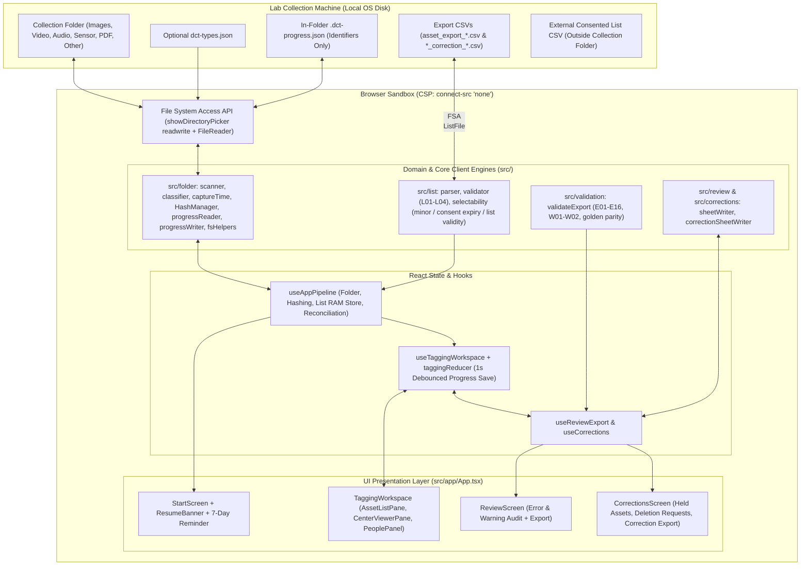
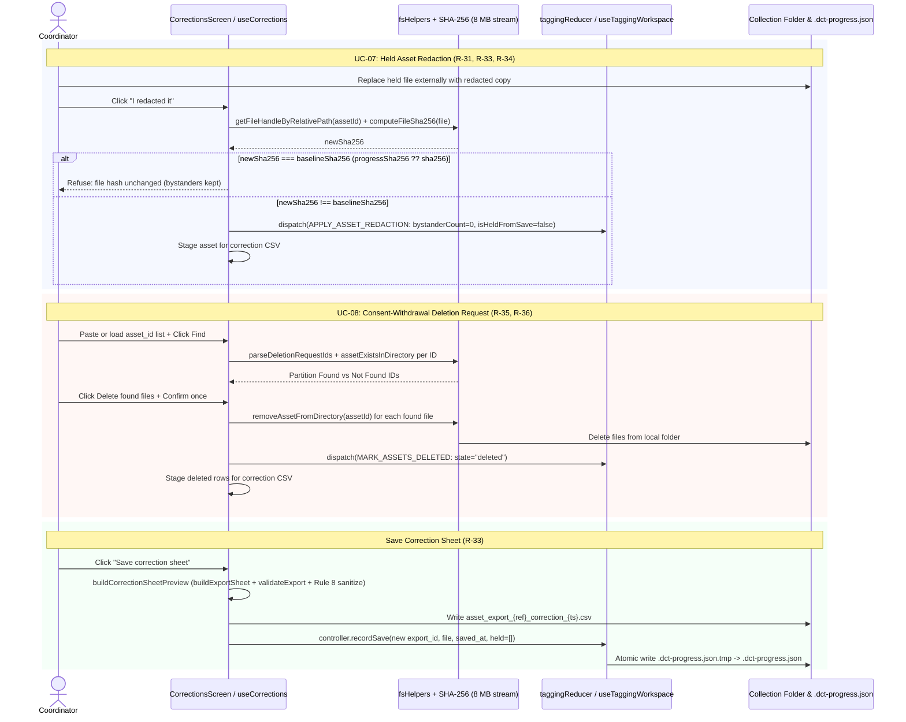

# Data Collection Tool (DCT) — Increment 4 Architecture & Implementation Summary

**Scope**: Increment 4 (*Progress Resume, Held-Asset Corrections & Deletion Requests*) + Complete System Architecture (Increments 1–4)  
**Git Milestone**: Merged to `main` via PR #3 (`f04e9f0` / commit `16c6d9c`), tagged `increment-4-done`  
**Use Cases Delivered**: **UC-05** (Resume a collection), **UC-07** (Correct held assets), **UC-08** (Process a deletion request), plus **R-37** (7-day list deletion reminder)

---

## 1. Executive Summary

Increment 4 completes the end-to-end operational lifecycle of the **Data Collection Tool (DCT)** after initial tagging and export. While Increments 1–3 established air-gapped folder ingestion, consented list validation, multi-modal asset viewers, bystander constraints, and deterministic CSV export validation, Increment 4 makes long-running collection work resilient across reloads and enables post-export governance:

1. **Crash-Safe Resume & Folder Reconciliation (UC-05)**: Automatically detects `.dct-progress.json` on folder open, restores tags and review states without storing participant names, enforces project identity matching (`RESUME_MISMATCH`), and flags files that are `missing`, newly added (`untagged`), modified on disk (`changed — check tags`), or previously `deleted`.
2. **Held-Asset Bystander Lock & Corrections (UC-07)**: Any asset exported with bystanders remains *held* until the coordinator either replaces it externally with a redacted copy verified by SHA-256 change (**I redacted it** — clears bystander count and keeps tagged people) or removes the file (**I deleted it** — marks `state: "deleted"`). No other UI control can clear held bystanders (`R-34`).
3. **Consent-Withdrawal Batch Deletion Requests (UC-08)**: Coordinators can paste or load a list of `asset_id`s to withdraw; the app partitions them into **Found** vs **Not Found**, deletes all found files from disk under a single batch confirmation, and stages `deleted` rows into a validated correction sheet.
4. **Validated Correction-Only Exports**: Writes `asset_export_<collection_ref>_correction_<YYYYMMDDTHHMMSSZ>.csv` containing strictly the corrected assets, preserving `collection_ref`, issuing a fresh `export_id`, appending to `.dct-progress.json` `saves[]`, and validating against the full TypeScript port of `tools/validate_export.py`.
5. **7-Day Consented-List Deletion Reminder (`R-37`)**: Surfaces an actionable reminder on the Start screen whenever the latest saved export in `.dct-progress.json` is more than 7 days old.

---

## 2. Complete System Architecture

DCT is a **100% client-side, air-gapped React + TypeScript SPA** running in Chromium-based browsers (Chrome/Edge) over the File System Access API. There is no backend, SSR, telemetry, or post-load network connectivity (`connect-src 'none'`).

### 2.1 High-Level Air-Gapped Layered Architecture

### 2.2 Screen Navigation & Reconciliation Data Flow

```mermaid
flowchart LR
  Open["1. Open Collection Folder (scanFolder + readProgressFile)"] --> CheckProg{".dct-progress.json present?"}

  CheckProg -- "No" --> Fresh["Fresh StartBanner + HashManager (2 workers, 8 MB chunks)"]
  CheckProg -- "Yes" --> Reconcile["reconcileFolderWithProgress (none, missing, untagged, changed, deleted)"]

  Reconcile --> Reminder{"Latest save > 7 days?"}
  Reminder -- "Yes" --> Warn7d["Show list-deletion-reminder (R-37)"]
  Reminder -- "No" --> Banner["Show ResumeBanner (Counts, Lists, Last Save)"]
  Warn7d --> Banner

  Fresh --> LoadList["2. Load Consented List CSV (RAM Only)"]
  Banner --> LoadList

  LoadList --> MatchProj{"Matches progress.project_id?"}
  MatchProj -- "No" --> Reject["Refuse List: RESUME_MISMATCH (R-09)"]
  MatchProj -- "Yes" --> Ready{"Ready on StartScreen"}

  Ready -- "Proceed / Resume collection" --> Workspace["TaggingWorkspace (Restores tags, enforces R-34 held lock)"]
  Ready -- "Previous saves exist -> Corrections & Deletions" --> Corrections["CorrectionsScreen"]

  Workspace -- "1s debounce auto-save" --> ProgressFile[".dct-progress.json (Atomic write via .tmp)"]
  Workspace -- "Go to Review" --> Review["ReviewScreen (validateExportWithConsentedList)"]
  Workspace -- "Previous saves exist -> Corrections & Deletions" --> Corrections

  Review -- "Valid & all done -> Save sheet" --> SaveFull["Write asset_export_{ref}_{ts}.csv + recordSave()"]
  SaveFull --> ProgressFile

  Corrections -- "Save correction sheet" --> SaveCorr["Write asset_export_{ref}_correction_{ts}.csv + recordSave()"]
  SaveCorr --> ProgressFile
```

### 2.3 Increment 4 Core Sequences (Redaction & Deletion Requests)

---

## 3. Repository Structure & Module Responsibilities

| Module | Files | Key Symbols & Responsibilities |
|---|---|---|
| **App Shell & Pipeline** | `src/app/App.tsx` `src/app/BrowserGate.tsx` `src/app/capabilities.ts` `src/app/useAppPipeline.ts` | Browser File System Access gate (`BrowserGate`); 4-screen routing (`start`, `workspace`, `review`, `corrections`); central pipeline (`useAppPipeline`) coordinating folder scan, progress read & reconciliation, 2-worker hashing (`HashManager`), in-memory consented list validation, bidirectional `RESUME_MISMATCH` enforcement, and `updateRedactedAssetFile` / `markFilesDeleted` callbacks. |
| **Folder, Hashing & Progress** | `src/folder/scanner.ts` `src/folder/classifier.ts` `src/folder/captureTime.ts` `src/folder/sha256.ts` `src/folder/hashWorker.ts` `src/folder/hashManager.ts` `src/folder/fsHelpers.ts` `src/folder/progressWriter.ts` `src/folder/progressReader.ts` `src/folder/types.ts` | Recursive folder discovery (skipping dotfiles & DCT exports), `dct-types.json` extension overrides, EXIF (`exifr`) + MP4/MOV (`mp4box.js`) + `lastModified` capture time extraction, FIPS 180-4 8 MB chunked `StreamingSha256` & `computeFileSha256`, subdirectory traversal & removal (`fsHelpers`), atomic `.dct-progress.json` serialization (`buildProgressDocument`, `writeProgressFile`, `createDebouncedProgressSaver`), Zod validation (`ProgressDocumentSchema`), resume reconciliation (`reconcileFolderWithProgress`), active held tracking (`getActiveHeldAssetIds`), and 7-day reminder check (`isListDeletionReminderDue`). |
| **Consented List Engine** | `src/list/parser.ts` `src/list/validator.ts` `src/list/selectability.ts` `src/list/types.ts` | Strict CSV list parsing and validation (`L01–L04`), RAM-only storage (`ConsentedListResult`), per-person and per-asset selectability evaluation (`evaluateSelectability`: minor check, `consent_expires_at` vs asset `capturedAt`, `list_valid_until` boundary). |
| **Tagging Workspace** | `src/tagging/types.ts` `src/tagging/reducer.ts` `src/tagging/selectors.ts` `src/tagging/useTaggingWorkspace.ts` `src/tagging/AssetListPane.tsx` `src/tagging/PeoplePanel.tsx` `src/tagging/TaggingWorkspace.tsx` | Tri-pane tagging UI, reducer state machine (selecting/removing consented people, bystander stepper `0–20`, `no_person` exclusivity, media `reviewedToEnd` / `externalReviewConfirmed`), Increment 4 actions (`APPLY_ASSET_REDACTION`, `MARK_ASSETS_DELETED`, `MARK_ASSETS_HELD_FROM_SAVE`, `CONFIRM_CHANGED_TAGS`), lifecycle status badges (`missing`, `changed — check tags`, `deleted`, `untagged`), held-bystander floor (`minAllowedBystander = isHeldFromSave ? 1 : 0`), and debounced 1 s `.dct-progress.json` auto-save. |
| **Multi-Modal Viewers** | `src/viewers/CenterViewerPane.tsx` `src/viewers/ImageViewer.tsx` `src/viewers/VideoViewer.tsx` `src/viewers/AudioViewer.tsx` `src/viewers/SensorViewer.tsx` `src/viewers/DocumentViewer.tsx` `src/viewers/FallbackViewer.tsx` `src/viewers/mimeTypes.ts` | Blob URL-based native inspection for image (pan/zoom), video (speed, frame step, ended tracking), audio, sensor CSV/TSV/JSON/TXT/LOG text preview, PDF iframe, and fallback UI; Increment 4 viewer states for `deleted` assets (`deleted-asset-viewer`), `missing` files (`missing-asset-viewer`), and `changed` hashes (`changed-asset-banner` with `Confirm tags match file` for non-held assets). |
| **Review & Full Export** | `src/review/sheetWriter.ts` `src/review/useReviewExport.ts` `src/review/ReviewScreen.tsx` `src/review/types.ts` | Builds RFC 4180 export CSV rows (`buildExportSheet`), assigns UUID v4 `export_id`, warns on PII in filenames (`R-30`), excludes `deleted` assets from missing-hash/file-date warnings, writes `asset_export_<collection_ref>_<YYYYMMDDTHHMMSSZ>.csv` to disk (plus Download copy), and calls `recordSave` to record `held[]` assets in `.dct-progress.json`. |
| **Corrections & Deletions** | `src/corrections/types.ts` `src/corrections/correctionSheetWriter.ts` `src/corrections/useCorrections.ts` `src/corrections/CorrectionsScreen.tsx` `src/corrections/index.ts` | **New in Increment 4.** Re-hashes held assets on disk (`redactHeldAsset`), deletes single held assets (`requestDeleteHeldAsset` / `confirmDeleteHeldAsset`) and batches of withdrawal requests (`parseDeletionRequestIds`, `checkDeletionRequests`, `confirmBatchDelete`), previews & validates correction-only CSVs (`buildCorrectionSheetPreview`), strips participant names from validator findings (`sanitizeFinding`), writes collision-safe correction CSVs (`buildCorrectionFileName`), and records new `export_id` saves. |
| **Start Screen & Resume UI** | `src/ui/StartScreen.tsx` `src/ui/ResumeBanner.tsx` `src/ui/FolderSection.tsx` `src/ui/ListSection.tsx` `src/ui/AssetTable.tsx` `src/ui/ListSummary.tsx` `src/ui/ParticipantTable.tsx` `src/ui/ListErrorBanner.tsx` `src/ui/types.ts` | Setup flow (`Open collection folder` -> `Load consented list` -> `Collection Reference Name`), `ResumeBanner` showing reconciled counts (`restoredTaggedCount`, `untaggedNewIds`, `missingIds`, `changedIds`), last save details, `Corrections & Deletions` navigation, `list-deletion-reminder`, and CTA switch from **Start tagging** to **Resume collection**. |
| **Validator & Parity** | `src/validation/validateExport.ts` `src/validation/types.ts` `tools/validate_export.py` `tools/test_validate_export.py` | TypeScript port of the canonical Python reference validator (`L01–L04`, `E01–E16`, `W01–W02`, microsecond ISO UTC parsing, strict BOM rejection), validated against all 18 golden CSV cases (`docs/consent-tagging/examples/golden/expected.json`). |

---

## 4. Increment 4 Deep Dive: State, Reconciliation & Invariants

### 4.1 `.dct-progress.json` Format & Privacy Boundary

`ProgressDocumentSchema` in [`src/folder/progressReader.ts`](../../src/folder/progressReader.ts) and [`src/folder/progressWriter.ts`](../../src/folder/progressWriter.ts) defines the persisted in-folder progress file:

- **Top-level fields**: `format` (`"dct.progress"`), `format_version` (`1`), `collection_ref`, `project_id` (lowercase UUID), `list_generated_at`, `assets` (keyed by `asset_id`), and `saves[]`.
- **Per-asset entry (`ProgressAssetEntry`)**: `sha256`, `captured_at`, `captured_at_source` (`"exif" | "media_header" | "file_modified"`), `asset_type`, `person_ids[]`, `bystander_count` (`0..20`), `no_person`, `reviewed_to_end`, `external_review_confirmed`, and `state` (`"active" | "deleted"`).
- **Per-save entry (`ProgressSaveEntry`)**: `export_id` (lowercase UUID), `file`, `saved_at`, and `held[]` (asset IDs exported with `bystander_count > 0`).
- **Structural privacy guarantees (`AGENTS.md` Rule 8)**:
  - Participant `displayName` and `contactHint` never appear in `.dct-progress.json`, `saves[]`, URLs, `localStorage`, `sessionStorage`, IndexedDB, logs, or UI error strings.
  - `ProgressDocumentSchema.safeParse()` strips any unknown keys from disk JSON before state hydration.
  - `sanitizeFinding()` in `correctionSheetWriter.ts` scrubs any accidentally matched participant name or contact hint out of validation error strings before UI display.
- **Atomic writes**: `writeProgressFile()` writes JSON to `.dct-progress.json.tmp` and uses `FileSystemFileHandle.move('.dct-progress.json')` when available, falling back to direct target write plus `.tmp` cleanup.
- **Race/loop guards in `useTaggingWorkspace.ts`**: Uses `appliedProgressRef`, `suppressNextAutoWriteRef`, and `lastSavedDigestRef` so hydrating from `.dct-progress.json` does not immediately trigger a redundant overwrite, while subsequent edits flush within 1 s (or explicitly via `flushProgress()` / `recordSave()`).

### 4.2 Folder Reconciliation Matrix (`reconcileFolderWithProgress`)

| Disk State | Progress Entry State | Reconciled `discrepancy` | UI & Tagging Behavior |
|---|---|---|---|
| Present, hash matches | `state: "active"`, matching `sha256` | `none` | Tags, `bystanderCount`, `noPerson`, and media review flags restored; counted in `restoredTaggedCount`. |
| Present, hash differs (or null mismatch skipped) | `state: "active"`, `progSha !== diskSha` | `changed` | Asset status shows `changed — check tags`; `isAssetDone` = `false`; `CenterViewerPane` shows `changed-asset-banner`. Non-held assets can confirm tags match (`CONFIRM_CHANGED_TAGS`); held assets must go through Corrections (**R-34**). |
| Present on disk | `state: "deleted"` | `changed` | Flagged in `changedIds` (`changed — check tags`) so unexpected file reappearance is never silently exported. |
| Present on disk | Absent from `progress.assets` | `untagged` | Included in `untaggedNewIds`; starts fresh in Tagging Workspace. |
| Absent from disk | `state: "active"` | `missing` | Shown in `missingIds` and flagged `missing`; editing controls locked in `PeoplePanel`; `CenterViewerPane` displays `missing-asset-viewer`. |
| Absent from disk | `state: "deleted"` | `deleted` | Preserved in `deletedIds` and workspace state; `isAssetDone` = `true`; excluded from missing-file and missing-hash warnings. |

### 4.3 Security & Data Integrity Controls

- **Content Security Policy (`index.html`)**:
  `default-src 'self'; img-src 'self' blob:; media-src blob:; frame-src blob:; object-src 'none'; connect-src 'none'; script-src 'self'; style-src 'self' 'unsafe-inline'`
- **Read-Only Asset Handling (`R-38`)**: Ingestion, capture time parsing (`exifr` / `mp4box.js`), viewing, and SHA-256 hashing (`StreamingSha256`) never modify original assets. Only explicit coordinator confirmations in **Corrections** call `removeAssetFromDirectory()`.
- **Locked ID Discipline (`R-13`)**: `project_id`, `person_id`, and `consent_id` have zero free-text inputs anywhere in the DOM; `consent_id` is looked up fresh from in-memory `ConsentedListResult` during sheet construction.
- **No Unintended Clearing of Bystanders (`R-34`)**: Once an asset is marked `isHeldFromSave` (from `saves[].held` in `.dct-progress.json` or immediately after `MARK_ASSETS_HELD_FROM_SAVE`), `PeoplePanel` disables decrementing `bystanderCount` below `1`, the reducer blocks `DECREMENT_BYSTANDER` below `1` and ignores `CONFIRM_CHANGED_TAGS`, and only `APPLY_ASSET_REDACTION` (hash verified changed on disk) or `MARK_ASSETS_DELETED` (file confirmed removed) can clear bystanders.

---

## 5. Use Cases & Requirements Coverage Matrix (Increment 4 Focus)

| Use Case | Requirement | Rule Summary | Implementation | Verification |
|---|---|---|---|---|
| **UC-02 / UC-05** | `R-09` | Refuse consented list whose `project_id` differs from `.dct-progress.json` (either load order). | `useAppPipeline.ts` (`loadListFromText` & `ingestFolderHandle`) -> `RESUME_MISMATCH` | `e2e/corrections-resume.spec.ts` (**T-10**), `tests/unit/ui/adversarial_m4.test.tsx` |
| **UC-05** | `R-22` | Debounced 1 s save to `.dct-progress.json` holding identifiers only (no names or contact hints). | `progressWriter.ts`, `progressReader.ts`, `useTaggingWorkspace.ts` | `tests/unit/folder/progressWriter.test.ts`, `progressReader.test.ts`, `e2e/corrections-resume.spec.ts` (**T-10**) |
| **UC-05** | `R-23` | Flag missing files as `missing`, new files as `untagged`, changed hashes as `changed — check tags`. | `reconcileFolderWithProgress()`, `ResumeBanner.tsx`, `selectors.ts`, `AssetListPane.tsx`, `CenterViewerPane.tsx` | `tests/unit/folder/progressReader.test.ts`, `tests/unit/tagging/resumeReducer.test.ts`, `e2e/corrections-resume.spec.ts` (**T-10**) |
| **UC-05** | `R-24` | Reload / crash recovery loses at most the last second of tagging (`1000 ms` debounce + explicit flush). | `createDebouncedProgressSaver(1000)` + `flushProgress()` on route transitions | `e2e/corrections-resume.spec.ts` (**T-10**) |
| **UC-07** | `R-31` | **I redacted it** re-hashes file from disk; rejects unchanged SHA-256; clears bystanders & retains tagged people on change. | `useCorrections.ts` (`redactHeldAsset`), `sha256.ts` (`computeFileSha256`), `reducer.ts` (`APPLY_ASSET_REDACTION`) | `tests/unit/corrections/useCorrections.test.tsx`, `e2e/corrections-resume.spec.ts` (**T-11**) |
| **UC-07** | `R-32` | **I deleted it** verifies deletion from folder or deletes after single confirmation and marks asset `deleted`. | `useCorrections.ts` (`requestDeleteHeldAsset`, `confirmDeleteHeldAsset`), `fsHelpers.ts`, `reducer.ts` (`MARK_ASSETS_DELETED`) | `tests/unit/corrections/useCorrections.test.tsx`, `e2e/corrections-resume.spec.ts` (**T-12**) |
| **UC-07** | `R-33` | **Save correction sheet** writes only corrected assets with matching `collection_ref`, new `export_id`, validates, and records in `saves[]`. | `correctionSheetWriter.ts` (`buildCorrectionSheetPreview`, `writeCorrectionSheetToDirectory`), `useCorrections.ts` (`saveCorrectionSheet`) | `tests/unit/corrections/correctionSheetWriter.test.ts`, `e2e/corrections-resume.spec.ts` (**T-11**, **T-12** + Python CLI check) |
| **UC-07** | `R-34` | Held bystander count cannot be cleared except through **R-31** or **R-32**. | `reducer.ts` (`isHeldFromSave` floor & `CONFIRM_CHANGED_TAGS` guard), `PeoplePanel.tsx` (`minAllowedBystander`) | `tests/unit/tagging/resumeReducer.test.ts`, `tests/unit/ui/adversarial_m4.test.tsx`, `e2e/corrections-resume.spec.ts` (**T-11**) |
| **UC-08** | `R-35` | Paste or load deletion `asset_id`s; display **Found** vs **Not Found** in folder. | `parseDeletionRequestIds()`, `useCorrections.ts` (`checkDeletionRequests`), `CorrectionsScreen.tsx` | `tests/unit/corrections/useCorrections.test.tsx`, `e2e/corrections-resume.spec.ts` (**T-12**) |
| **UC-08** | `R-36` | One batch confirmation deletes all found files from disk and stages `deleted` rows into the correction sheet. | `useCorrections.ts` (`requestBatchDelete`, `confirmBatchDelete`), `fsHelpers.ts` (`removeAssetFromDirectory`) | `tests/unit/corrections/useCorrections.test.tsx`, `e2e/corrections-resume.spec.ts` (**T-12**) |
| **UC-08** | `R-37` | Start screen displays reminder to delete consented list file when last saved sheet is > 7 days old. | `progressReader.ts` (`isListDeletionReminderDue`), `ResumeBanner.tsx` (`list-deletion-reminder`) | `tests/unit/folder/progressReader.test.ts`, `e2e/corrections-resume.spec.ts` (**T-14 / R-37**) |

---

## 6. Acceptance Tests & Verification Results

### 6.1 Increment 4 Acceptance Tests (`e2e/corrections-resume.spec.ts` + Unit Suites)

- **T-10 (Resume — `R-09`, `R-22`–`R-24`)**: Tags assets and reloads cleanly; **Resume collection** restores all tags; inspects `.dct-progress.json` to confirm zero participant display names or contact hints; refuses wrong-project consented list with `RESUME_MISMATCH`; flags deleted disk asset as `missing` and newly dropped file as `untagged` (and verifies changed hash detection as `changed — check tags`).
- **T-11 (Correction — `R-31`, `R-33`, `R-34`)**: Attempts **I redacted it** on held `IMG-0002.png` before replacing on disk (refused, bystander count preserved); confirms bystander count cannot be cleared via workspace controls (`R-34`); replaces `IMG-0002.png` with redacted copy and clicks **I redacted it** (re-hashes, clears bystanders to 0, keeps tagged person); saves correction sheet and validates with `tools/validate_export.py` (`VALID: 1 rows, 1 assets, 0 errors, 0 warnings`).
- **T-12 (Deletions — `R-32`, `R-35`, `R-36`)**: Submits deletion request containing `IMG-0003.png` (Found) and `NOPE.png` (Not Found); single confirmation removes `IMG-0003.png` from disk and saves a validated 1-row `deleted` correction sheet (`tools/validate_export.py` -> `VALID`). Also verifies single-asset held deletion via **I deleted it** on `IMG-0002.png`.
- **T-14 (7-Day List Deletion Reminder — `R-37`)**: Verifies `ResumeBanner` displays `list-deletion-reminder` when the latest entry in `.dct-progress.json` `saves[]` is more than 7 days old.

### 6.2 Verified Command Outputs (Commit `16c6d9c` / `main` `f04e9f0`)

| Check | Scope / Command | Verified Result |
|---|---|---|
| **TypeScript Typecheck** | `npx tsc --noEmit` | Exit 0 (0 errors) |
| **ESLint** | `npm run lint` (`eslint . --max-warnings 0`) | Exit 0 (0 errors, 0 warnings) |
| **Production Build** | `npm run build` (`tsc --noEmit && vite build`) | Exit 0 (`1648` modules transformed; built `dist/` cleanly in `7.37s`) |
| **Python Validator Tests** | `python -m unittest tools/test_validate_export.py` | **20 / 20 tests OK** (`0.099s`) |
| **Vitest Unit & Adversarial Suite** | `npx vitest run --maxWorkers=1 --minWorkers=1` | **28 / 28 test files**, **350 / 350 tests passed** (`99.18s`) |
| **Playwright Chromium E2E** | `npx playwright test --project=chromium` | **31 passed, 1 skipped** (`T-02.5` Firefox-only browser gate test skipped in Chromium; Firefox executable absent in host cache) (`51.6s`) |
| **Reference CSV Validation** | `python tools/validate_export.py` on saved T-11 (`IMG-0002.png`) and T-12 (`IMG-0003.png`, `IMG-0002.png`) correction sheets | **`VALID: 1 rows, 1 assets, 0 errors, 0 warnings`** on each |

---

## 7. Remaining Scope (Increment 5 Roadmap)

Per [`docs/consent-tagging/implementation-plan.md`](implementation-plan.md), Increment 5 completes final polish, performance, and packaging:
- Full keyboard navigation audit and automated `axe` accessibility verification (**T-13** / `R-17`).
- 1,000-asset scale run + 4 GB video background hashing benchmark and filename-contains-participant-name (`R-30`) E2E checks (**T-14**, **T-16**).
- Byte-for-byte asset immutability verification after full tag-and-save workflows (**T-16** / `R-38`).
- End-user operator guide with screenshots in `docs/`, plus Firefox **T-02.5** verification in CI where Firefox is installed.
