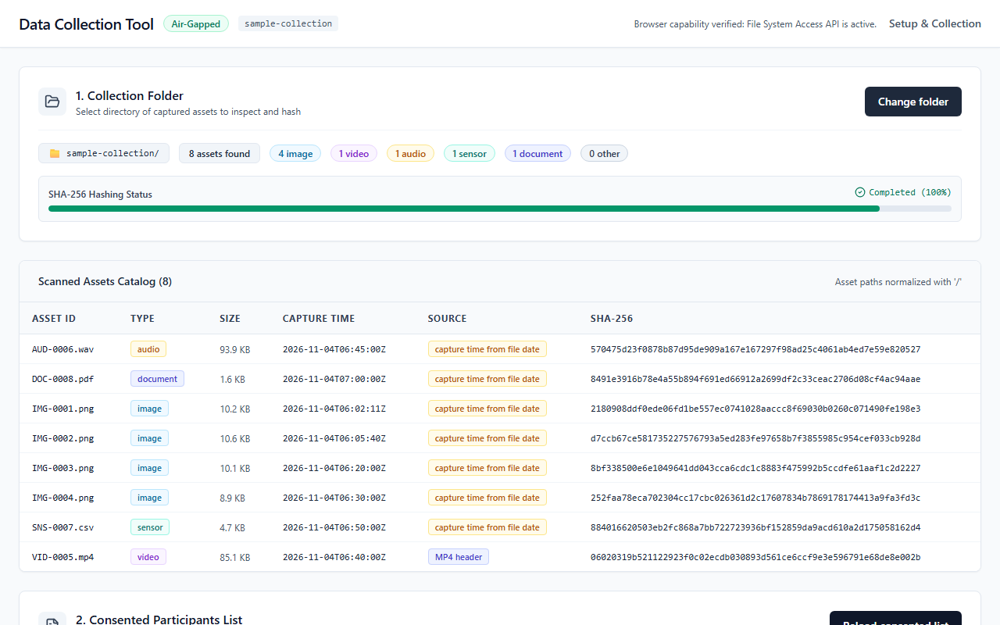
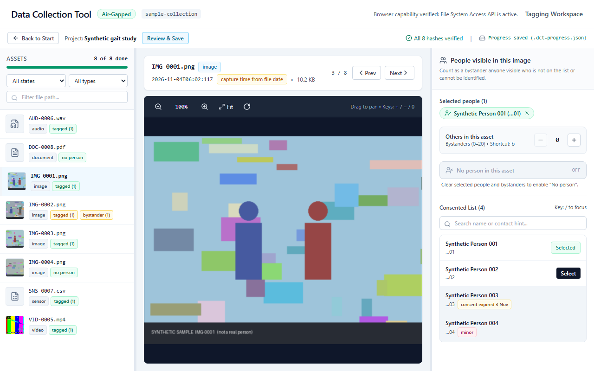
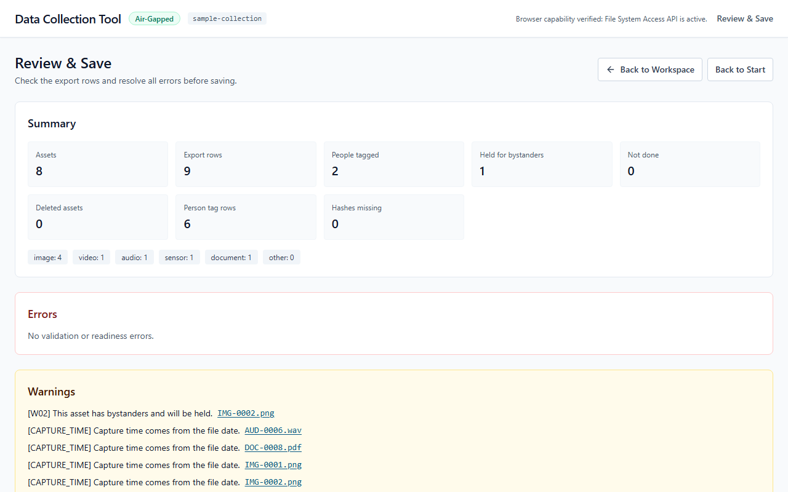
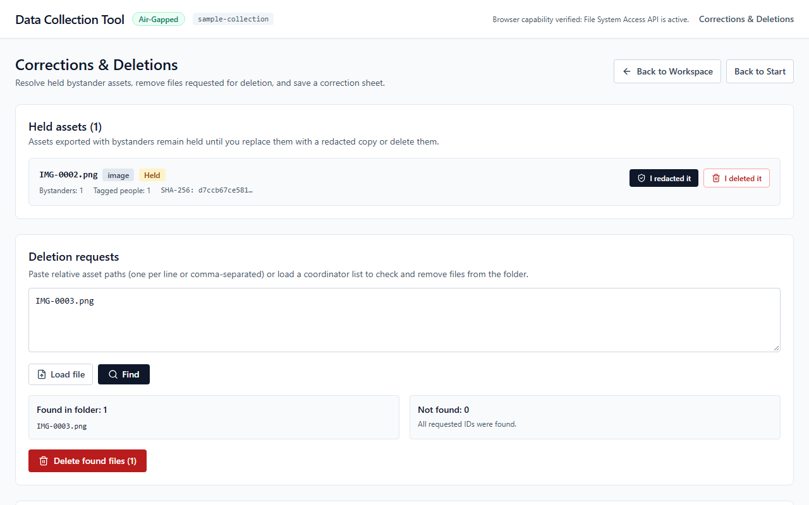

# Data Collection Tool (DCT) — User Guide

The **Data Collection Tool (DCT)** runs locally in your browser on the lab's collection machine. You open a folder of captured files and the project's consented participants list, tag who appears in each file, review errors and warnings, and save the CSV metadata sheet directly into the collection folder.

- **Air-gapped & private**: After the page loads, zero network requests are made (`connect-src 'none'`). Participant names stay in memory only and are never written to browser storage, `.dct-progress.json`, logs, or URLs.
- **Non-destructive**: Your captured image, video, audio, sensor, and document files are never re-encoded, renamed, or overwritten during tagging or export. Files are only deleted if a coordinator explicitly confirms a deletion in **Corrections & Deletions**.
- **Supported browsers**: Desktop **Google Chrome** or **Microsoft Edge** (served over `http://localhost` or HTTPS; other browsers show the unsupported-browser notice).

---

## 1. Quick Start

From the project root:

```bash
npm ci
npm run build
npm run preview
```

Open Chrome or Edge to `http://localhost:4173`.

---

## 2. Opening & Resuming a Collection (Start Screen)



1. **Open collection folder**: Click **Open collection folder** and choose the folder containing your captured files.
   - Every file in the folder and subfolders is listed with `/` separators (`asset_id`) and classified (`image`, `video`, `audio`, `sensor`, `document`, `other`). Hidden dotfiles and previous `asset_export_*.csv` files are excluded automatically.
   - If the folder contains an optional `dct-types.json` mapping (for example `{"sensor": [".edf", ".bin"]}`), custom extensions are applied immediately.
   - Capture timestamps are read from EXIF `DateTimeOriginal` (converted from the configured capture timezone to UTC), MP4/MOV `mvhd` creation time, or file last-modified time (flagged in the table).
   - SHA-256 checksums stream in the background in 8 MB chunks so large folders and multi-gigabyte videos keep the interface responsive.
2. **Load consented list**: Click **Load consented list** and choose the project's `consented_list_*.csv` file (usually kept outside the collection folder).
   - The app validates rules `L01–L04`; invalid files are refused whole with the rule code.
   - When resuming a folder that already has `.dct-progress.json`, lists for a different `project_id` are refused (`RESUME_MISMATCH`).
   - Minors (`is_minor = true`) and participants whose consent had already expired are clearly badged and cannot be selected.
3. **Confirm collection name & proceed**: Review the editable **Collection Reference** (`collection_ref`, prefilled from the folder name), then click **Start tagging** (or **Resume collection** if `.dct-progress.json` was detected).

### Resume Banner & 7-Day Reminder
- When reopening a folder with `.dct-progress.json`, the Start screen displays how many assets were **Restored tagged**, newly added (**New untagged**), removed from disk (**Missing files**), or edited since the last save (**Changed files**).
- If the most recent saved export is more than **7 days** old, a reminder banner prompts you to delete the consented list CSV from the collection machine once the export is accepted.

---

## 3. Tagging Assets (Tagging Workspace)



The workspace has three resizable panes:

- **Left pane — Asset List**: Shows a preview thumbnail or type icon, relative `asset_id`, type pill, status badge, bystander badge, overall `X of Y done` progress, and filters by **state**, **type**, and **file path**.
- **Center pane — Viewer**: Displays metadata (`asset_id`, type, UTC capture time, time source, size, duration) and the built-in viewer:
  - **Images**: Pan by dragging; zoom via toolbar buttons or keyboard.
  - **Video & Audio**: Scrub bar, waveform (audio), playback speed (`0.5×–2×`), and `±1f` frame step (video). Media files are not considered *done* until played to the end or confirmed via **Mark reviewed outside the app**.
  - **Sensor text (`csv`, `tsv`, `json`, `jsonl`, `txt`, `log`)**: Displays the first 200 lines and total line count.
  - **PDF documents**: Opens natively in an embedded PDF viewer frame.
  - **Unsupported formats (`.heic`, `.mkv`, unrecognized codecs, `other`)**: Shows file type, size, capture time, and the guidance *"No preview in app — view this file in your usual viewer, then tag it here"*.
- **Right pane — People Panel**:
  - Heading states what "appears" means for the active asset type (for example *"People heard in this recording"* for audio).
  - Search participants by **display name** or **contact hint**. Click **Select** to add a person chip (`✕` removes a person prior to final export).
  - **Others in this asset (0–20)**: Records anyone who appears in the asset who is not on the consented list or cannot be identified.
  - **No person in this asset**: Mutually exclusive with selected people and bystanders; marks empty rooms or environmental sensor traces as *done*.
  - Assets with **only bystanders** and no consented person are never *done* and display *bystander only — delete this file*.

Progress is written atomically to `.dct-progress.json` (identifiers only) within **1 second** of each change. Use **Back to Start**, **Review & Save**, or **Corrections & Deletions** in the top bar at any time.

### Keyboard Shortcuts

| Context | Key | Action |
|---|---|---|
| Asset navigation | `↑` / `↓` or `←` / `→` | Previous / next asset in the filtered list |
| Video / Audio | `Space` | Play / pause media (when focus is on the list option or viewer canvas) |
| Image viewer | `+` / `−` / `0` | Zoom in / zoom out / reset zoom and pan |
| People search | `/` | Focus participant search box |
| Inside search box | `Enter` | Select the first matching selectable participant |
| Inside search box | `Escape` | Clear search query, then blur search box |
| Bystanders | `b` | Increment bystander count by 1 (up to 20) |
| Empty asset | `n` | Toggle **No person in this asset** |
| Pane splitters | `←` / `→` / `Home` / `End` | Resize left or right pane via keyboard when separator is focused |

---

## 4. Reviewing Errors, Warnings & Saving the Sheet (Review Screen)



1. Verify the **Summary** metrics (assets, export rows, unique people, held assets, not-done count, deleted count, missing hashes).
2. Inspect **Errors**: Any validator error (`E01–E16`) or not-done asset blocks saving; click any asset link to jump directly back to that asset in the workspace.
3. Inspect **Warnings** (export allowed):
   - `[W02]` Assets containing bystanders (these will be **held** on import until redacted or deleted).
   - `[CAPTURE_TIME]` Assets whose capture timestamp came from the file's last-modified date.
   - `[FILENAME_PII]` Asset filenames or subfolder paths matching a participant's name.
4. Click **Save sheet** once all hashes finish and **0 errors** remain. The app writes `asset_export_<collection_ref>_<YYYYMMDDTHHMMSSZ>.csv` into the collection folder and records the save in `.dct-progress.json`. Use **Download a copy** to download an identical CSV copy if needed.

Optional CLI verification on the saved folder:

```bash
python tools/validate_export.py --list <path-to-consented_list.csv> --export <folder>/asset_export_<ref>_<ts>.csv
```

---

## 5. Held-Asset Corrections & Deletion Requests (Corrections Screen)



Access **Corrections & Deletions** from the Start screen or top workspace bar whenever a collection has previous saves.

### Held Assets (Bystander Redaction or Deletion)
Bystander counts on previously saved assets are locked in the workspace and can only be cleared here:
- **I redacted it**: First replace the file in the collection folder externally with the redacted version, then click **I redacted it**. DCT re-hashes the bytes on disk; if the SHA-256 digest did not change, the action is refused. Once a new hash is verified, bystander count resets to `0` while keeping your consented people, and the asset is staged for a correction sheet.
- **I deleted it**: If the file still exists on disk, DCT prompts for confirmation before deleting it from the folder (or confirms it is already gone), marks the asset `deleted`, and stages a `deleted` row.

### Deletion Requests (Consent Withdrawal)
1. Paste one or more `asset_id`s (newline- or comma-separated) or load a `.txt`/`.csv` request list.
2. Click **Find** to partition requested IDs into **Found in folder** vs **Not found**.
3. Click **Delete found files** and confirm once to remove all found files from disk and stage their `deleted` rows.

### Saving a Correction Sheet
Review the staged counts (**Corrected**, **Deleted**, **Export rows**, and validation status), then click **Save correction sheet**. DCT validates the correction-only export (same `collection_ref`, new `export_id`), writes `asset_export_<collection_ref>_correction_<YYYYMMDDTHHMMSSZ>.csv`, and appends the export record to `.dct-progress.json`.

---

## 6. Post-Export Checklist

1. Deliver the **collection folder** (unchanged asset files + `asset_export_*.csv` + `.dct-progress.json`). Keep all exported sheets verified with `tools/validate_export.py`.
2. Delete the **consented list CSV** from the collection machine once the study team confirms receipt of the accepted export.
